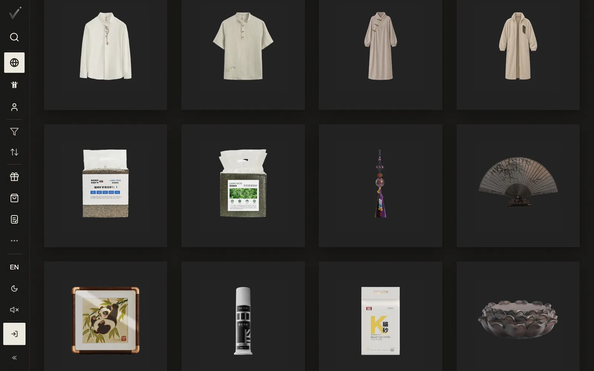
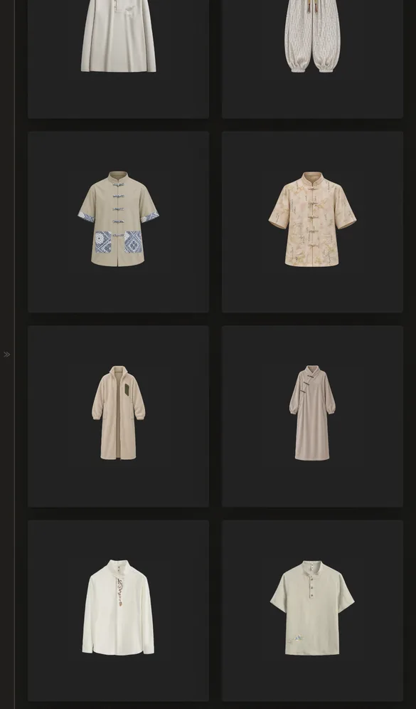

# 0.1.0 · 2026-11-01

[返回更新日志](../CHANGELOG.md)

### 方方正正的首页

卡片一样大，排成整齐的格子，照片整张放进去，不裁。手机两列，电脑四列，屏幕再宽就五到六列。

### 在 App 里打开

在 iPhone 或 iPad 上看帖子和商品，关闭按钮旁边多了一个「在 App 里打开」。

### 还有这些

- 精选按现在的价格算，跟结账一样。
- 按下付款以后，这一单的价格不会再变，库存也不会扣两次。
- 退款申请里的照片可以点开看大图。
- 没登录时写好的礼物留言，登录回来还在。
- 卖家添加库存时先填包裹的重量和尺寸，运费按真实的包裹算。

English

### A square home page

Cards are one size in a tidy grid, each photo shown whole and never cropped. Two columns on a phone, four on a computer, five or six on wider screens.

### Open in App

On an iPhone or iPad, post and product pages show Open in App beside the close button.

### Also

- Picks prices each item at its current price, the same as checkout.
- Once you press pay, that order's price no longer changes, and stock is never taken twice.
- Photos in a refund request open full size.
- A gift message written before signing in is still there after you sign in.
- Sellers enter the parcel's weight and size when adding stock, so shipping is quoted on the real parcel.

