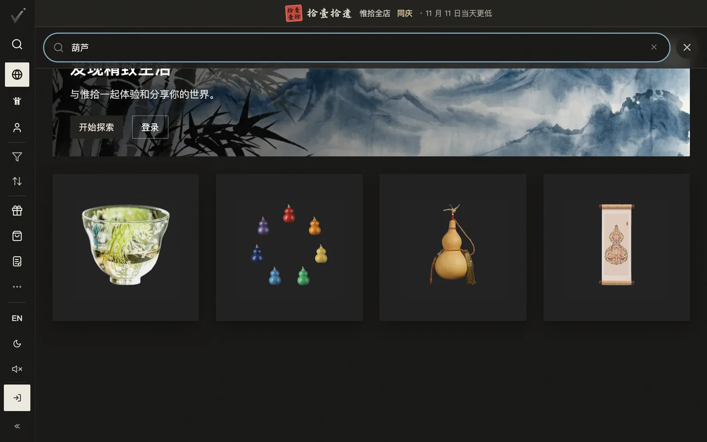
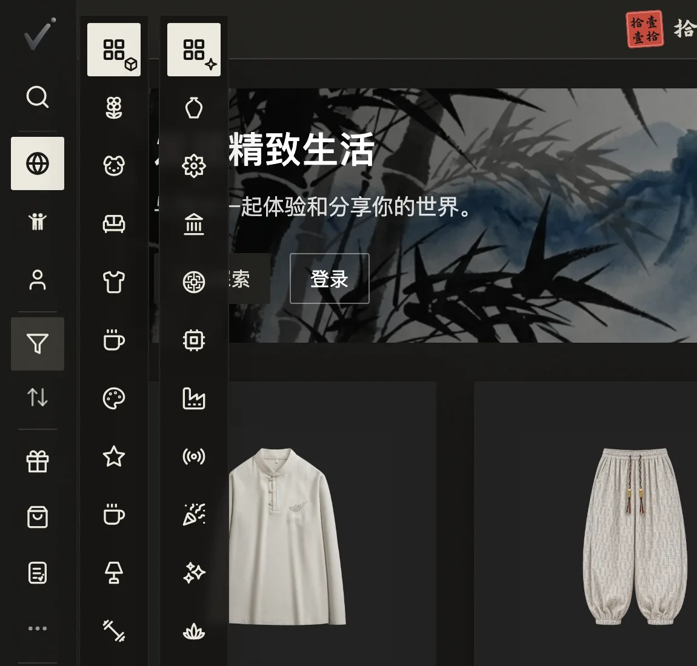
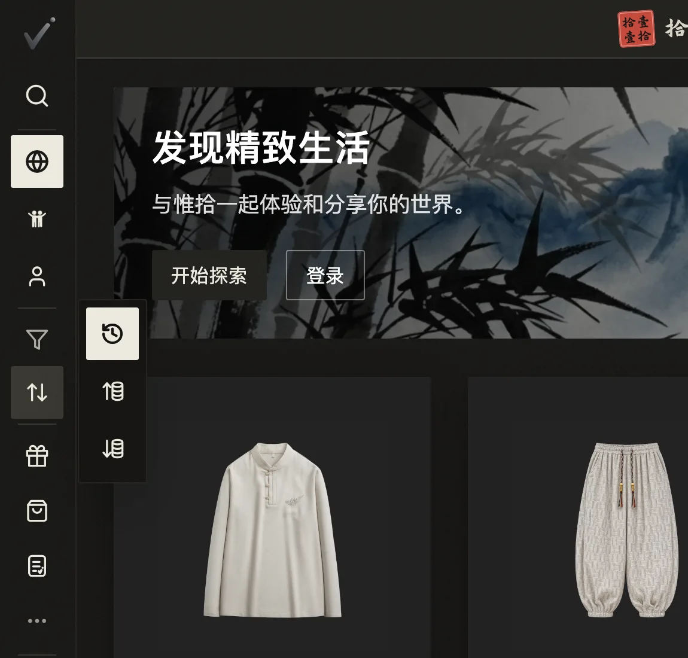
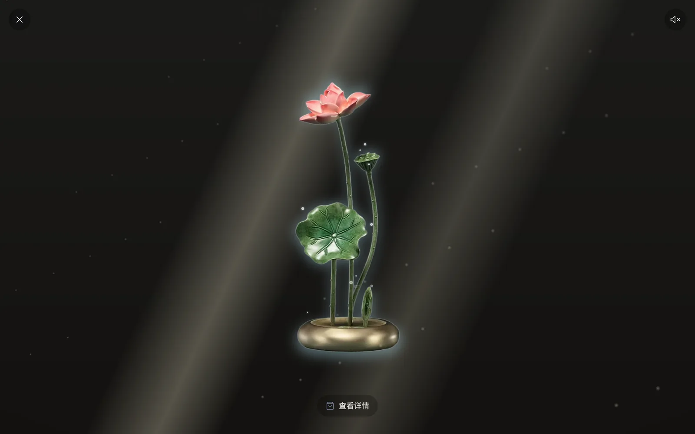
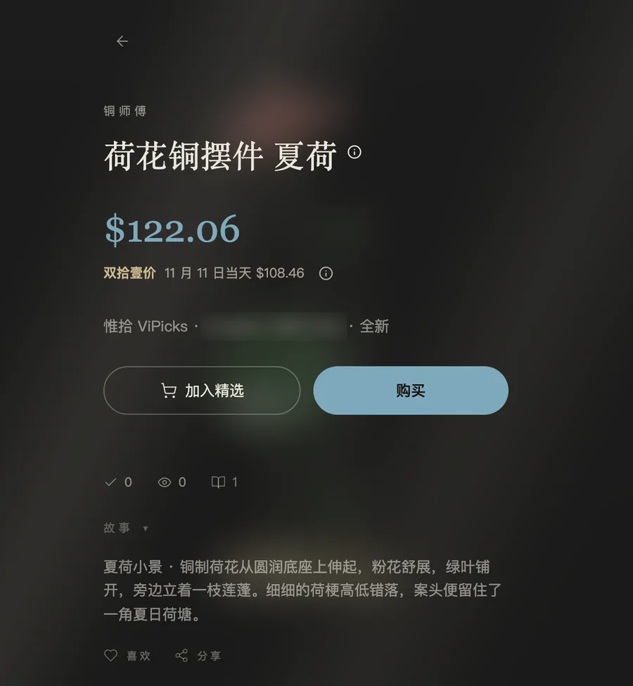

# 0.2.0 · 2026-11-04

[返回更新日志](../CHANGELOG.md)

### 首页直接搜

点左栏的放大镜，打字，首页的商品当场变少。中文英文都能搜。

### 筛选和排序

左栏的「筛选」分两列，类别和感觉，可以一起选。感觉里多了禅意和吉祥。排序就在它下面，按最新或按价格，刷新后还在。

### 点开商品

先看到大图或 3D。想买再点「查看详情」，价格、成色、发货城市和故事都在里面。

### 价格以 6 或 8 结尾

新定的价格和双拾壹价，最后一位都是 6 或 8。上面这件荷花铜摆件标价 A$135.56，活动价 A$122.06，11 月 11 日当天 A$108.46。

### 还有这些

- 商品名不再截断；没有品牌的，就不写品牌。
- 精选里的卡片换成了抠图。
- 「全部购买」直接算上这一组的经济运费，不用等到结账。
- 关注只剩一个按钮，写着关注、已关注、回关或好友。关注数不再显示，谁关注了谁只有两个人自己看得到。
- 首页第一屏的抠图从约 31 MB 减到约 0.5 MB。

English

### Search from the home page

Tap the magnifier in the left rail and type: the products on the home page narrow as you go. Chinese and English both work.

### Filter and sort

The rail's Filter has two columns, Type and Vibe, and you can pick in both. Vibe gains 禅意 and 吉祥. Sort sits right below it, by newest or by price, and it survives a refresh.

### Opening a product

You see the large picture or the 3D model first. View details shows the price, condition, dispatch city and stories.

### Prices end in 6 or 8

New prices and Double Eleven prices end in 6 or 8. The lotus ornament above is listed at A$135.56, A$122.06 in the campaign and A$108.46 on 11 November.

### Also

- Product names show in full, and a product without a brand shows no brand.
- Cards in Picks show the product's cutout.
- Buy All includes the group's economy shipping, so you see the total before checkout.
- Following is one button that reads Follow, Following, Follow back or Friends. Follower counts are gone, and who follows whom is visible only to the two people.
- The cutouts on the home page's first screen went from about 31 MB to about 0.5 MB.

