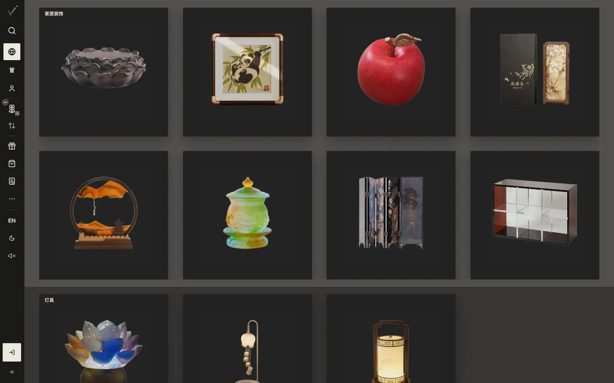
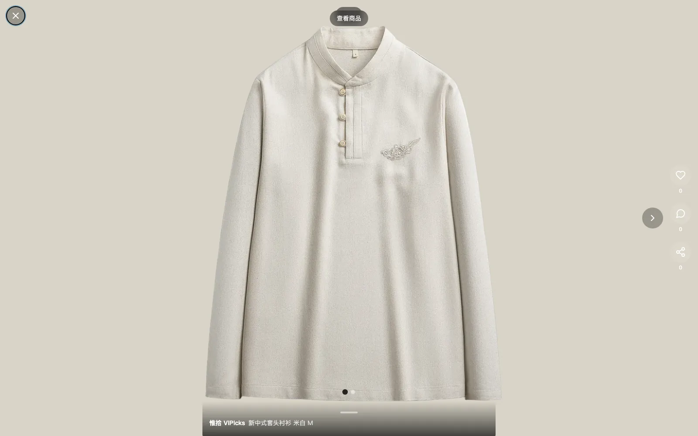
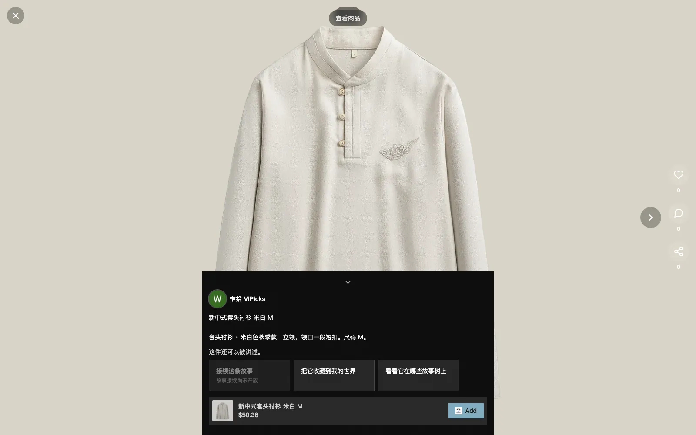

# 0.3.0 · 2026-11-05

[返回更新日志](../CHANGELOG.md)

### 首页按类别摆成货架

在左栏的「筛选」里选一个类别，首页不再只是把网格筛窄，而是摆成货架：每个类别一行，方卡片左右翻页，电脑上一页 4×2，手机上 2×4。往下滚就换下一个类别。什么都不选时，还是原来的网格。

### 帖子全屏

打开一条帖子，图片铺满屏幕，底下只留一条线。点一下或往上拖，说明和商品就拉上来；往下拖、点旁边或按 Esc 收回去。

### 写商品的故事先收起来

印章里的书本图标，和点开它看到的故事列表，先收起来了。帖子里的「接续这条故事」现在写着「故事接续尚未开放」。商品自己的说明还在「故事 ▾」里，跟以前一样。

### 发帖要先开店

发帖需要一家已开通的 E家小店，并在设置里登记 ABN。还没开店的账号，在分享页会看到说明和申请入口。

### 官方小店可以送实物礼物

ViPicks 的官方小店惟拾送礼时，可以把礼物绑在自己的一条商品帖子上，送那件实物。收礼的人打开链接收下礼物，填一个收件地址，小店按地址寄出。寄出前可以随时撤回地址；地址只交给寄礼的店和快递公司，用完会自动删除。

### 卖家的库存页

- 下架的商品折成一行「已下架」，可以重新上架。下架后会一直是下架，直到你重新上架，结账也不会卖它。
- 还没发帖的商品，那一格变成「发帖」按钮。
- 地址簿和发货卡片会说还有几件商品不在 Sell 地址，按一下就改过去。

### 还有这些

- 换账号或退出登录后，地址只显示当前账号的。
- 商品的展示图读不出来时，不再显示破图标。

English

### Shelves on the home page

Pick a category in the rail's Filter and the home page becomes shelves: one row per category, square cards paged left and right, 4×2 on a computer and 2×4 on a phone. Scroll down for the next category. With nothing picked, it is the usual grid.

### Posts open full screen

A post's picture fills the screen, with one line at the bottom. Tap it or drag it up for the caption and the product; drag down, tap outside or press Esc to put them away.

### Stories about a product are put away for now

The book icon in the seal, and the list of stories it opened, are put away for now. Continue this story in a post now reads Story continuation is not open yet. The product's own description is still under 故事 ▾, as before.

### Posting needs a store

To post, you need an approved E家小店 store with an ABN on file in Settings. An account without one sees a note and the way to apply on the share page.

### The official store can send a real gift

When 惟拾, ViPicks' own store, sends a gift bound to one of its product posts, the gift can be that item itself. The recipient opens the link, keeps the gift and gives a delivery address, and the store posts it. The address can be withdrawn until the gift is posted; it goes only to the store and its carrier, and once it has served its purpose it is deleted automatically.

### For sellers

- Withdrawn listings fold into one Withdrawn line, with Relist. A withdrawn listing stays withdrawn until you relist it, and checkout will not sell it.
- A listing with no post shows a Post button.
- The address book and the shipping card say how many listings are not at your Sell address, and move them with one tap.

### Also

- After switching accounts or signing out, address lists show only the current account's addresses.
- A product's display picture that cannot load no longer shows a broken icon.

