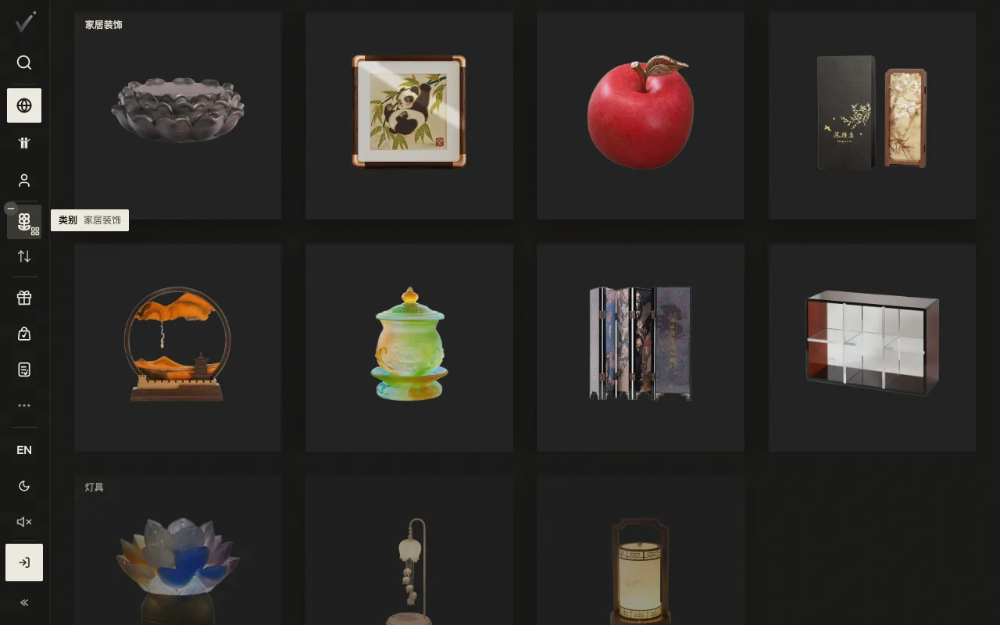
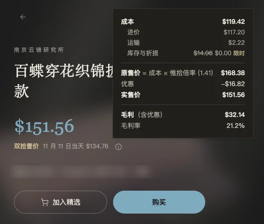

# 0.3.1 · 2026-11-07

[返回更新日志](../CHANGELOG.md)

### 首页的分组货架

首页的分组货架现在会吸附：一组对齐屏幕顶部，展开后组名一直留在上方。电脑上滚轮滚一格，换到下一组。当前分组会亮起来，不再靠底色区分。开了「减少动态效果」的设备不吸附。

### 双拾壹的价格明细

惟拾的 91 件双拾壹商品，点价格旁的 ⓘ 能看到这件东西的价是怎么来的：成本（进价、运输、库存与折损）、原售价、优惠、实售价和毛利。活动结束后只对朋友显示。

### 商品的故事回来了

商品印章里的书本图标回来了，旁边是故事的数量，点开是「它的故事」。现在只能读，写故事还没开放。

### 新的购物袋图标

左栏的「精选」和帖子里的「加入」换成同一个空心购物袋图标，不再是一张带白底的图片。

### 页脚和「关于」

页面底部的页脚回来了，可以从这里进「关于」。页脚链到的隐私政策、条款、网站地图、配送和 Cookie 五页，在中文页上都是中文。隐私政策开头也写明以英文版为准，和条款一样。

### 联系我们

「联系我们」写明实时客服还在准备中，现在请发邮件。

### 结账

- 付款前的说明只讲什么时候发货。
- 订单摘要先写卖家，再写你和你的收件地址。
- 运送方式只写快递公司的名字。
- 订单摘要里的商品图用商品卡片上那张，背景跟随主题，和方框左边对齐。

### 头像

上传头像以前在网站上会失败，现在能传了。

### 发帖和卖家

- 发帖前要先填真实姓名和电话，申请开店时也要填，之后可以在账号设置里改。只有平台看得到，买家和别的卖家看不到。
- 库存页里，撤下的商品不再在两处重复出现。
- 商品卡片和订单页不再显示商品编号，卖家那边照旧。

English

### Home shelves

The grouped shelves on the home page now snap: a group lines up with the top of the screen, and its name stays above it while the group is open. On a computer, one notch of the wheel moves to the next group. The current group lights up, in place of the background tones. Devices set to reduce motion do not snap.

### Double Eleven price breakdown

On 惟拾's 91 Double Eleven products, the ⓘ beside the price shows how the price is made: the cost (purchase, freight, stock and breakage), the original price, the discount, the price paid and the margin. It stops showing when the sale ends.

### Product stories are back

The book icon in a product's seal is back, with the number of stories beside it, and opens Its stories. Stories can be read; writing one is not open yet.

### One bag icon

Picks in the rail and Add in a post now use the same outline bag icon, in place of a picture with a white box.

### Footer and About

The footer is back at the bottom of the page, with About. The five pages it links to (privacy, terms, sitemap, shipping and cookies) are in Chinese on the Chinese pages. The privacy policy now says at its start that the English text governs, as the terms do.

### Contact

The Contact page says live support is on its way, and to write by email for now.

### Checkout

- The note before you pay says only when the order ships.
- The order summary names the seller first, then you and your delivery address.
- Delivery options name the carrier alone.
- Item pictures in the order summary are the ones on the product cards, on the theme's background, flush with the box.

### Profile picture

Uploading a profile picture used to fail on the website. It works now.

### Posting and selling

- Posting now asks for your real name and phone first, as applying for a store does; you can change them in your account settings. Only the platform sees them, not buyers or other sellers.
- A withdrawn listing no longer shows twice on the inventory page.
- Product cards and order pages no longer show the product code; seller pages keep it.

