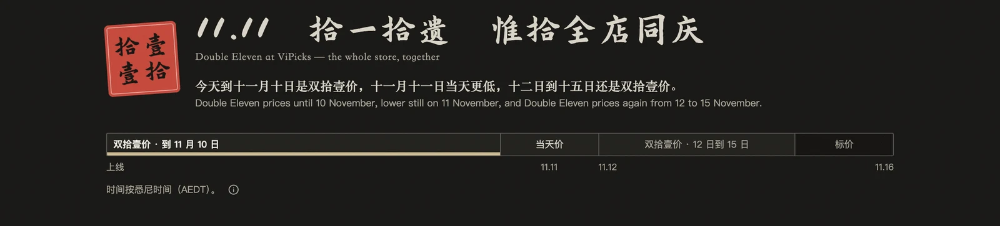
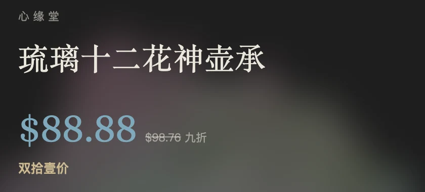

# 0.3.2 · 2026-11-08

[返回更新日志](../CHANGELOG.md)

### 双拾壹延长到 11 月 15 日

11 月 10 日以前是双拾壹价，11 日当天价更低，12 日到 15 日回到双拾壹价，16 日 0 点（悉尼时间）恢复标价。活动页的时间条多了 12 到 15 日这一段。

### 琉璃十二花神壶承

这件每天都是 $88.88，11 月 11 日当天和之后也一样，不参加当天价。商品页价格右边用灰色小字写着划掉的标价和「九折」。

### 首页的默认顺序

首页默认按相似排列：挨着的商品意思和样子都接近，排法跟着你屏幕上的列数。

### 价格明细

价格明细里，惟拾免收的库存与折损费按进价的 5% 计，划掉，实收 $0。价格和毛利都没变。

### 结账

- 付款卡片上不再写发货时间，订单摘要里还有。
- 订单摘要底部重复的运费合计一行去掉了，上面已经写了运费。

### 开店

第一次开托管店之前，要先在账号里填好真实姓名和电话。托管页会说明还缺什么，带你去填。

English

### Double Eleven runs to 15 November

Double Eleven prices until 10 November, the lower day price on 11 November, Double Eleven prices again from 12 to 15 November, and list prices from 00:00 on 16 November (Sydney time). The time bar on the campaign page has a window for 12 to 15 November.

### The 'Lotus Harmony Brings Wealth' Tea Tray

This tray is $88.88 every day, on 11 November and after too: it takes no day price. Its product page shows the list price struck through in small grey type beside the price, with "10% off".

### The home page's default order

The home page is ordered by similarity by default: items next to each other are close in meaning and in look, laid out for the number of columns on your screen.

### Price breakdown

In the price breakdown, the stock and breakage cost the ViPicks store waives is 5% of the purchase price, struck through and charged at $0. Prices and margins are unchanged.

### Checkout

- The payment card no longer says when the order ships; the order summary still does.
- The order summary no longer repeats the delivery total at the bottom; the postage is shown above it.

### Opening a store

Before opening a first hosted store, the account needs a real name and phone number on file. The hosting page says what is missing and takes you there.

