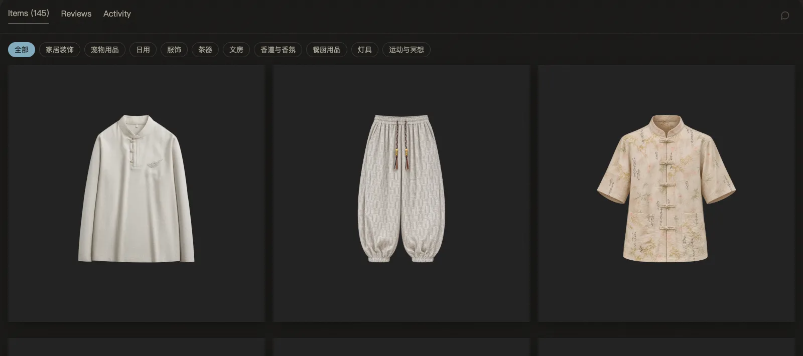

# 0.4.0 · 2026-11-10

[返回更新日志](../CHANGELOG.md)

### 商品都在同一种方框里

个人主页和店铺的「物品」、店铺的探索页、「喜欢」和精选里的商品，现在都和首页一样：商品抠图放在主题色的方框上，鼠标移上去有一圈光，点开就进入商品。在「物品」页点开，看到的是这个卖家的这件商品。

### 好友折扣卡

在设置里可以做一张好友折扣卡，把链接发给朋友。对方接受后，你们在彼此的店里买东西都是 95 折。一个链接只能被接受一次。任何一方都可以结束这张卡：你给对方的折扣马上停，对方给你的 24 小时后停。

### 给喜欢的帖子分组

「喜欢」页可以建自己的分组：选几篇喜欢的帖子放进去，之后可以改名、增减或删掉。分组只有你自己看得到。取消喜欢，帖子也会从分组里拿掉。

### 按时间顺序排

排序多了「时间顺序」，最早的排在前面。另外三种还在：时间倒序、价格从低到高、价格从高到低。

### Aramex 报价

有些地名在 Aramex 那边写法不同，以前这些地址拿不到 Aramex 的报价。现在会用同一邮编下的其他写法去问，能报价也能下单；包裹上和你在 ViPicks 看到的，仍然是你自己填的地名。

English

### Every product in the same box

Products on a profile's or store's Items tab, a store's Explore page, Liked and Picks now look like the home page: the product's cut-out on a box in the theme colour, a soft glow on hover, and a click opens the product. From the Items tab, a click opens that seller's own listing.

### Friend discount cards

In Settings you can make a friend discount card and send its link to a friend. Once they accept, you each pay 95% in the other's store. A link can be accepted only once. Either of you can end the card: the discount you give stops at once, the one you receive stops 24 hours later.

### Groups for liked posts

The Liked page lets you make your own groups: pick some posts you like, then rename the group, change what is in it or delete it. Only you can see your groups. Unliking a post takes it out of every group.

### Oldest first

Sorting now has Oldest first. Newest first and the two price orders are still there.

### Aramex quotes

Some suburbs are spelled differently in Aramex's list, so those addresses used to get no Aramex quote. Now the other names of the same postcode are tried, so they can be quoted and booked; the parcel and everything you read on ViPicks keep the suburb as you wrote it.

