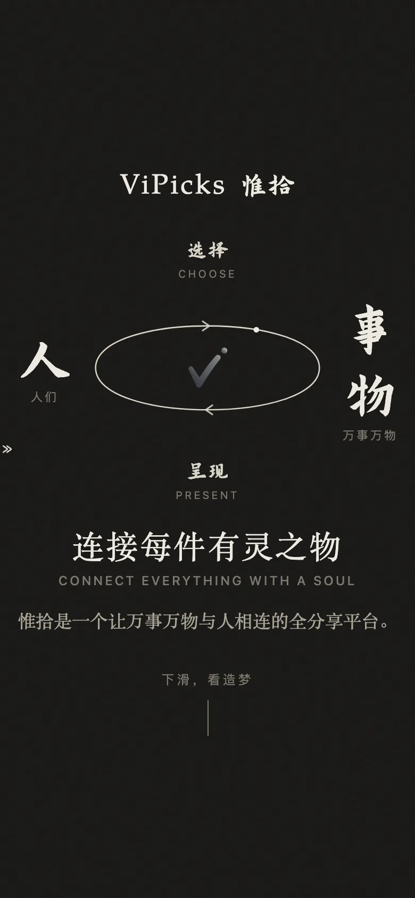

# 0.5.0 · 2026-11-15

[返回更新日志](../CHANGELOG.md)

### 已拾：为买到的东西拾一段故事

订单页上，买到的东西可以「拾一段故事」：拍几张照片，答几道选择题就能生成，之后还能改。发布还没开放，故事先替你收着。卖家订好运单约两小时后，你会收到一封带故事入口的邮件。

### 好友与惟拾伙伴折扣卡

互相关注之后，可以在对方主页「加好友」，对方通过就是好友；好友自提现在只在好友之间。左栏好友列表里的 ＋ 可以用完整邮箱或 8 位惟拾ID 找人，你的惟拾ID在个人资料页上。

好友折扣卡改名「惟拾伙伴折扣卡」，11 月 11 日起是 9 折（原来 95 折）。卡只能发给和你互相关注的人，收下即成为好友；互相关注期间，你们在彼此的店里都是 9 折。卖家给互相关注的人设的折扣，改叫「互惠价」。

### 订单留言和发货时间

订单页可以给这一单的卖家留言，对方的话可以一键翻译，有新留言会发邮件提醒。商品页写明多久内发货，由卖家设定，1 到 30 个工作日；订单页写明每个包裹承诺的时间和寄出的日期。

### 条款与隐私

服务条款、隐私政策和 Cookie 政策在 11 月 15 日更新，每页开头写明改了什么；对你不如以前的改动，12 月 15 日起才适用。服务条款新增防诈骗一节：只在 ViPicks 结账页付款。「关于」页的封面写着「连接每件有灵之物」。

### 还有这些

- 左栏出现在几乎每个页面上，默认收起；语言、主题和声音固定在左栏底部。
- 个人设置、卖家主页、地址簿和订单详情页，跟着你选的语言显示。
- 申请开店和发帖不再要求 ABN，填真实姓名和电话即可。

English

### Picked: tell the story of what you bought

On the order page, a thing you bought can now get its story: add a few photos and answer some multiple-choice questions, and the story is made, ready for you to change. Publishing is not open yet, so the story is kept for you. About two hours after the seller books the label, an email brings you the way into the story.

### Friends and the ViPicks Mate Card

Once you follow each other, you can Add friend on their profile; when they accept, you are friends, and friend pickup is now between friends only. The + in the rail's friends list finds one person by full email or 8-character ViPicks ID; yours is on your profile page.

The friend discount card is now the ViPicks Mate Card, and since 11 November it gives 10% off (it was 5%). A card goes only to someone you follow who follows you back, and accepting it makes you friends; while you follow each other, you both get 10% off in each other's stores. The discount a seller sets for people who follow each other is now called the Mutual Price.

### Order messages and dispatch times

On the order page you can message the seller about that order and translate the other side's messages with one tap, and a new message brings an email. Product pages say how soon an item ships, as the seller sets it (1 to 30 business days), and the order page says what was promised for each parcel and the day it was sent.

### Terms and privacy

The Terms of Service, Privacy Policy and Cookie Policy were updated on 15 November, each opening with a note of what changed; a change that gives you less applies from 15 December. The terms add a section on scams: pay only on the ViPicks checkout page. The About page's cover now reads "Connect everything with a soul".

### Also

- The left rail is on almost every page, folded at first, with language, theme and sound at its foot.
- Settings, a seller's profile, the address book and the order details page follow the language you choose.
- Applying to sell and posting no longer ask for an ABN: a real name and phone are enough.

